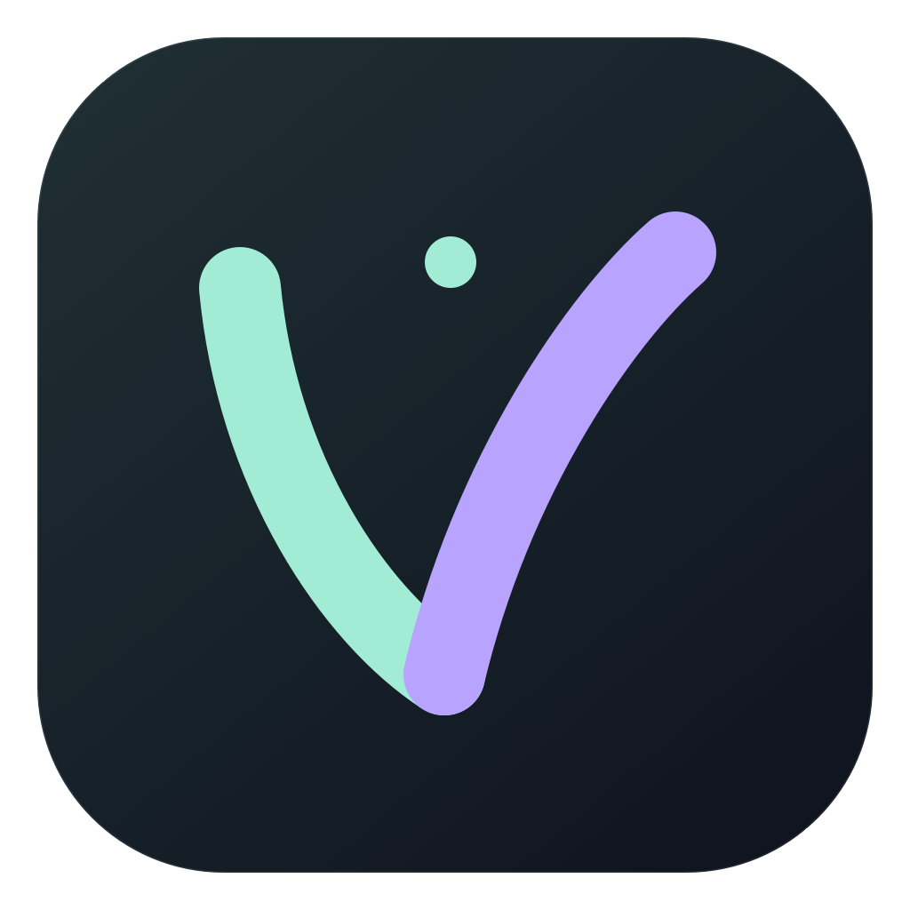

<div align="center">



# VELIN

---

**Stay in the conversation. Find the words. Keep your own AI.**

A free, open-source desktop assistant for macOS and Windows.<br />
Live questions, concise answers, and your choice of AI — in one compact workspace.


[Quick start](#quick-start) · [Download](#download--install) · [All versions](#all-versions) · [Product tour](#made-for-the-moment) · [Windows guide](docs/WINDOWS.md) · [Development](#build-from-source)

**FREE TO DOWNLOAD. FREE TO USE. NO VELIN SUBSCRIPTION.**<br />
AI provider API usage is billed separately. macOS early release · Windows x64 preview.

</div>

<p align="center"></p>

---

## Free means free

**VELIN costs $0 to download and use.** No VELIN account, subscription, or paid feature unlocks. The source is available under the MIT license.

You choose the AI connection. Commercial providers bill API usage separately; their chat subscriptions do not include API credits. You can also connect a local model through Ollama, with no VELIN or API subscription. Local models run on your own hardware.

## Why choose VELIN over Cluely?

VELIN is built to be a better fit for people who want a free app, their own providers, and control over their data:

- **Your AI, your choice.** Keep up to five connections and switch between OpenAI, Claude, Gemini, OpenRouter, Groq, Ollama, or a compatible endpoint.
- **Speak, then press Enter.** The other side’s speech becomes a live question in Conversation. Press Enter in VELIN, or Control+Option+Return from another app, to answer without typing.
- **Answers you can read at a glance.** A short answer first, followed by rounded Say this, Next step and Explain more buttons. Ready buttons reveal content prepared in the same request.
- **A compact native interface.** A movable floating bar, aligned controls, smooth opening and closing sections, and the original mint/lilac design.
- **Local history and secure keys.** API keys stay in macOS Keychain through a VELIN-only authenticated component, or Windows Credential Manager. Sessions and notes stay on your device. Relevant context goes to the provider only when you ask.
- **Source you can inspect and change.** Build your own version and keep using it without a VELIN service account.

VELIN is independent software with its own code, artwork, and provider integrations. Broad performance comparisons have not been benchmarked.

## Download & install

| Platform | Download | Install |
| --- | --- | --- |
| **macOS · Apple Silicon** | `VELIN-X.Y.Z-macOS-arm64.dmg` | Open DMG, drag **VELIN → Applications**, eject, then open VELIN. macOS 14+. |
| **Windows · x64 preview** | `VELIN-X.Y.Z-Windows-x64.zip` or `.exe` | Extract ZIP and open **VELIN.exe**. Portable, includes .NET runtime. Windows 11 x64. |

**Windows releases start at v0.1.2.** Versions 0.1.0 and 0.1.1 are macOS-only. Both platforms share the release number from 0.1.2 onward.

Choose an actual published asset below, or upload the prepared local files through GitHub Releases. The macOS app is locally self-signed and **not Apple-notarized**. The Windows EXE is **unsigned** and has not yet been run on Windows; [preview scope and setup](docs/WINDOWS.md) lists the differences and required runtime checks. A Windows build is not evidence of Windows feature parity or call reliability.

### All versions

<!-- VERSIONS:START -->
| Version | Status | macOS · Apple Silicon | Windows · x64 |
| --- | --- | --- | --- |
| 0.2.1 | [DMG](https://github.com/jzc9307/VELIN/releases/tag/v0.2.1) | [EXE · preview](https://github.com/jzc9307/VELIN/releases/tag/v0.2.1) |
| 0.2.0 | Latest | [DMG](https://github.com/jzc9307/VELIN/releases/download/v0.2.0/VELIN-0.2.0-macOS-arm64.dmg) | [EXE · preview](https://github.com/jzc9307/VELIN/releases/download/v0.2.0/VELIN-0.2.0-Windows-x64.exe) |
| 0.1.2 | Published | [DMG](https://github.com/jzc9307/VELIN/releases/download/v0.1.2/VELIN-0.1.2-macOS-arm64.dmg) | [EXE · preview](https://github.com/jzc9307/VELIN/releases/download/v0.1.2/VELIN-0.1.2-Windows-x64.exe) |
| 0.1.1 | Published | [DMG](https://github.com/jzc9307/VELIN/releases/download/v0.1.1/VELIN-0.1.1-macOS-arm64.dmg) | Not available |
| 0.1.0 | Local · archived | Not published | Not available |
<!-- VERSIONS:END -->

Every published version keeps its own macOS and available Windows links. Newest prepared versions have no invented public download URL. See [release history](docs/RELEASES.md) and [changelog](CHANGELOG.md).

## New in v0.2.1

- **Updates inside VELIN.** A launch check, sidebar update card and download-progress screen lead to a verified download and restart. Install this updater-capable version once; future releases need the [signed update assets](docs/UPDATES.md).

- Scroll up through the full floating conversation; current reply actions stay at the bottom.
- In **Next step**, use **Yes, continue** to generate the detail it offers.
- Choose optional Soniox cloud speech for mixed-language recognition with your own speech API key. Audio goes to Soniox only from controls you explicitly start after enabling it; usage is billed by Soniox.
- Download offline models once, then switch between verified installed models. Turbo is a larger option, not a guarantee of accurate Malaysian slang.

## Added in v0.2.0

- **Computer audio first.** Listen transcribes the interviewer from computer audio; Mic independently dictates into your question box.
- **Local multilingual speech.** An optional model handles Malay, Mandarin and English, including the **Country → Malaysia** mixed-language preset. [Setup and honest limits](docs/LANGUAGES.md).
- **About me.** A dedicated background section and a guided, local introduction builder using only your facts.
- **A mode for the moment.** Interview, Behavioral Interview, Coding Interview, System Design, Case Interview, Recruiter Screen, Recruiting, Team Meet and Lecture join the existing modes. Each mode keeps its own instructions, response language and files.
- **A tighter assistant.** Less space between the toolbar and live transcript.

## Made for the moment

| Feature | How it works |
| --- | --- |
| Listen → Enter → answer | Computer audio supplies the other side’s question; Mic independently types into your question field. Nothing is automatically sent for an AI answer. |
| Continuous local speech | Supported languages use Apple’s continuous local engine on macOS 27+. Earlier systems/languages use the legacy Apple Speech path, with on-device recognition required by default. |
| Screen questions | Attach a screenshot, review its preview, then ask a vision-capable model. |
| Personal context | Save About me across modes; each mode has separate instructions, response language and context files (Mac also supports text PDFs). |
| Conversation modes | General, Meeting, interview variants, System Design, Case Interview, Recruiter Screen, Recruiting, Team Meet, Lecture, Coding, Study, Sales and Custom. |
| Notes and history | Search local sessions, generate/edit notes, import transcripts and export Markdown. |
| Quiet presentation | Hide the Dock and menu-bar icons, recover through a shortcut, and request best-effort capture exclusion. |

### Quick start

1. Open **AI Connections**, choose a provider and model, paste its API key, and save. Ollama uses your local server.
2. Choose your speech engine and approve the required permissions. Listen captures computer audio; Mic dictates into the question box. For Local multilingual, choose Malaysia and download or select a model.
3. Start **Listen** while your call runs on this computer. Read the other side’s words in Conversation or the floating bar.
4. Press **Enter** with VELIN focused. From another app, use **Control+Option+Return** on Mac or **Ctrl+Alt+Enter** on Windows.

The full transcript is available separately. You can type your own question at any time. See [Start here](docs/START-HERE.md) and the [user guide](docs/USER-GUIDE.md).

Mac shortcuts (see the [Windows shortcuts](docs/WINDOWS.md#shortcuts) for the preview):

| Action | Shortcut |
| --- | --- |
| Answer the pending spoken question in VELIN | Enter |
| Ask / answer from another app | Control + Option + Return |
| Show / hide assistant | Control + Option + Space |
| Start / stop listening | Control + Option + L |
| Attach screenshot | Control + Option + S |
| Move the visible assistant | Command + arrow keys |
| Hide assistant | Escape |

The feature tour above describes the native Mac app. Windows includes the core workflow, with a different local speech engine and a smaller feature set: see [Windows preview scope](docs/WINDOWS.md#preview-scope).

## Privacy and practical limits

- **Keys:** stored in macOS Keychain or Windows Credential Manager, never in source, settings JSON, or an `.env` file.
- **Sessions:** stored locally in `~/Library/Application Support/VELIN` with owner-only file permissions on Mac, or `%LOCALAPPDATA%\VELIN` under your Windows account. VELIN does not add a separate encryption password.
- **AI requests:** relevant transcript, chat, personal instructions and attached context go to your selected provider when you ask or generate notes. The provider’s processing and retention rules apply.
- **Audio:** captured only after Listen or Mic; no audio recording files are retained. Apple/local Whisper remain available. Optional Soniox cloud speech streams started audio controls to Soniox with separate consent and a separate API key. Computer audio can contain multiple apps/people and is labeled by source, not individual speaker.
- **Capture exclusion:** a best-effort legacy macOS hint. **No guarantee of invisibility in every screen-sharing app.** See [Apple’s sharing-type documentation](https://developer.apple.com/documentation/appkit/nswindow/sharingtype-swift.enum/none).
- **Availability:** provider models, credits and service capacity affect responses. There is no promise of zero initial AI latency. Speech language availability depends on macOS and its installed assets.

## Build from source

For Windows, use **.NET SDK 10** and `python scripts/build-windows.py`. The self-contained x64 EXE, guide and notices are written to ignored build output. See the [Windows build guide](docs/WINDOWS.md#build-from-source).

### macOS

Requires an Apple Silicon Mac, macOS 14+, Apple Command Line Tools or Xcode, Python 3.12+, and native CMake 3.22+ for the bundled local speech worker. The continuous macOS 27 speech path requires a macOS 27 SDK / Swift 6.4 toolchain; older toolchains compile the legacy path.

```bash
xcode-select --install  # if the Apple developer tools are missing
bash scripts/test.sh
python3 scripts/signing.py setup  # one-time local signing identity in your login Keychain
bash scripts/build.sh
```

A fresh clone creates `dist/VELIN.app`. `--check` compiles without signing or installing. No API credentials, private signing keys, or model weights are needed to compile. Speech assets may be prepared when you first use Listen.

In the local Project workspace, the inner **VELIN/** folder is the Git root, the one current **VELIN.app** sits beside it, caches stay in **work/**, and versioned installers stay in **outputs/**. Quit the app before replacing it. The signing identity supports local Keychain continuity; it is not Developer ID signing or notarization. Never upload its private key or `.local-signing.json`.

## Releases and contributing

Open the inner source folder in VS Code and push it to your chosen repository. Upload the prepared DMG, Windows EXE/ZIP, app/source ZIPs and checksums through GitHub Releases. Paste the supplied release-notes Markdown into the release description. Follow [GitHub upload instructions](docs/GITHUB-UPLOAD.md) and the [release workflow](docs/GITHUB.md).

A release request prepares the next patch, such as **0.1.0 → 0.1.1 → 0.1.2**. Retrying the same prepared release keeps its version. Ordinary Git commits or VS Code Push do not bump the app version.

The Mac app uses system frameworks; the Windows preview bundles .NET, NAudio and System.Speech with their notices. Preserve the bundled provider icon credits and licenses in [THIRD-PARTY.md](THIRD-PARTY.md). VELIN code and original artwork use the [MIT license](LICENSE). See [verification](docs/VERIFICATION.md) for what was actually tested.
