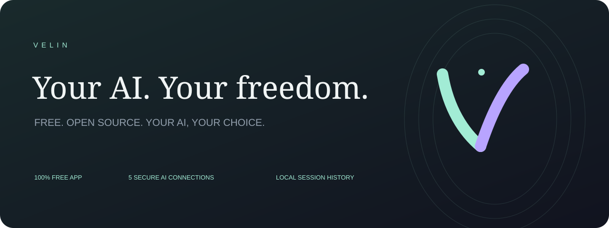

<div align="center">



# VELIN

**A better Cluely alternative. Free, open source, and under your control.**

A native Mac assistant that listens to the conversation, puts the other side’s words in front of you,<br />
and gives you a concise answer when you press **Enter**.

**FREE APP · NO VELIN SUBSCRIPTION · BRING YOUR OWN AI · MIT LICENSE**

[Download & install](#download--install) · [All versions](#all-versions) · [Features](#made-for-the-moment) · [User guide](docs/USER-GUIDE.md) · [Build from source](#build-from-source)

</div>

---

## Free means free

**VELIN costs $0 to download and use.** No VELIN account, subscription, or paid feature unlocks. The source is available under the MIT license.

You choose the AI connection. Commercial providers bill API usage separately; their chat subscriptions do not include API credits. You can also connect a local model through Ollama, with no VELIN or API subscription. Local models run on your own hardware.

## Why choose VELIN over Cluely?

VELIN is built to be a better fit for people who want a free app, their own providers, and control over their data:

- **Your AI, your choice.** Keep up to five connections and switch between OpenAI, Claude, Gemini, OpenRouter, Groq, Ollama, or a compatible endpoint.
- **Speak, then press Enter.** The other side’s speech becomes a live question in Conversation. Press Enter in VELIN, or Control+Option+Return from another app, to answer without typing.
- **Answers you can read at a glance.** A short answer first, followed by rounded Say this, Next step and Explain more buttons. Ready buttons reveal content prepared in the same request.
- **A compact native interface.** A movable floating bar, aligned controls, smooth opening and closing sections, and the original mint/lilac design.
- **Local history and secure keys.** API keys stay in macOS Keychain through a VELIN-only authenticated component; sessions and notes stay on your Mac. Relevant context goes to the provider only when you ask.
- **Source you can inspect and change.** Build your own version and keep using it without a VELIN service account.

VELIN is independent software with its own code, artwork, and provider integrations. Broad performance comparisons have not been benchmarked.

## Download & install

Download the **VELIN-X.Y.Z-macOS-arm64.dmg** attached to the GitHub Release you choose from All versions. Open the DMG, drag **VELIN.app → Applications**, eject the disk, and open VELIN from Applications.

**Apple Silicon · macOS 14+ · Early release**

The current installer is prepared locally for manual upload. Public download links are added after an actual GitHub Release is published. This build uses a local self-signed identity and is **not Apple-notarized**; macOS may require approval under Privacy & Security.

### All versions

<!-- VERSIONS:START -->
| Version | Status | macOS download |
| --- | --- | --- |
| 0.1.1 | Newest · prepared | Not published |
| 0.1.0 | Local · archived | Not published |
<!-- VERSIONS:END -->

Every published version keeps its own DMG link. Newest prepared versions have no invented public download URL. See [release history](docs/RELEASES.md) and [changelog](CHANGELOG.md).

## Made for the moment

| Feature | How it works |
| --- | --- |
| Listen → Enter → answer | Computer audio supplies the other side’s question; your microphone adds context. Nothing is automatically sent for an AI answer. |
| Continuous local speech | Supported languages use Apple’s continuous local engine on macOS 27+. Earlier systems/languages use the legacy Apple Speech path, with on-device recognition required by default. |
| Screen questions | Attach a screenshot, review its preview, then ask a vision-capable model. |
| Personal context | Set your own instructions and add text, Markdown, JSON or text-based PDF documents. |
| Conversation modes | General, Meeting, Coding, Study, Sales and Custom. |
| Notes and history | Search local sessions, generate/edit notes, import transcripts and export Markdown. |
| Quiet presentation | Hide the Dock and menu-bar icons, recover through a shortcut, and request best-effort capture exclusion. |

### Quick start

1. Open **AI Connections**, choose a provider and model, paste its API key, and save. Ollama uses your local server.
2. Enable the audio sources you want and approve macOS permissions during setup.
3. Start **Listen** while your call runs on this Mac. Read the other side’s words in Conversation or the floating bar.
4. Press **Enter** with VELIN focused, or **Control+Option+Return** from Teams or another app.

The full transcript is available separately. You can type your own question at any time. See [Start here](docs/START-HERE.md) and the [user guide](docs/USER-GUIDE.md).

| Action | Shortcut |
| --- | --- |
| Answer the pending spoken question in VELIN | Enter |
| Ask / answer from another app | Control + Option + Return |
| Show / hide assistant | Control + Option + Space |
| Start / stop listening | Control + Option + L |
| Attach screenshot | Control + Option + S |
| Move the visible assistant | Command + arrow keys |
| Hide assistant | Escape |

## Privacy and practical limits

- **Keys:** stored in macOS Keychain, never in source, settings JSON, or an `.env` file.
- **Sessions:** stored locally in `~/Library/Application Support/VELIN` with owner-only file permissions. VELIN does not add a separate encryption password.
- **AI requests:** relevant transcript, chat, personal instructions and attached context go to your selected provider when you ask or generate notes. The provider’s processing and retention rules apply.
- **Audio:** captured only after Listen; no audio recording files are retained. Computer audio can contain multiple apps/people and is labeled by source, not individual speaker.
- **Capture exclusion:** a best-effort legacy macOS hint. **No guarantee of invisibility in every screen-sharing app.** See [Apple’s sharing-type documentation](https://developer.apple.com/documentation/appkit/nswindow/sharingtype-swift.enum/none).
- **Availability:** provider models, credits and service capacity affect responses. There is no promise of zero initial AI latency. Speech language availability depends on macOS and its installed assets.

## Build from source

Requires an Apple Silicon Mac, macOS 14+, Apple Command Line Tools or Xcode, and Python 3. The continuous macOS 27 speech path requires a macOS 27 SDK / Swift 6.4 toolchain; older toolchains compile the legacy path.

```bash
xcode-select --install  # if the Apple developer tools are missing
bash scripts/test.sh
python3 scripts/signing.py setup  # one-time local signing identity in your login Keychain
bash scripts/build.sh
```

A fresh clone creates `dist/VELIN.app`. `--check` compiles without signing or installing. No API credentials, private signing keys, or model weights are needed to compile. Speech assets may be prepared when you first use Listen.

In the local Project workspace, the inner **VELIN/** folder is the Git root, the one current **VELIN.app** sits beside it, caches stay in **work/**, and versioned installers stay in **outputs/**. Quit the app before replacing it. The signing identity supports local Keychain continuity; it is not Developer ID signing or notarization. Never upload its private key or `.local-signing.json`.

## Releases and contributing

Open the inner source folder in VS Code and push it to your chosen repository. Upload the prepared DMG, app/source ZIPs and checksums through GitHub Releases. Paste the supplied release-notes Markdown into the release description. Follow [GitHub upload instructions](docs/GITHUB-UPLOAD.md) and the [release workflow](docs/GITHUB.md).

A release request prepares the next patch, such as **0.1.0 → 0.1.1 → 0.1.2**. Retrying the same prepared release keeps its version. Ordinary Git commits or VS Code Push do not bump the app version.

Source has no runtime package dependencies. Preserve the bundled provider icon credits and licenses in [THIRD-PARTY.md](THIRD-PARTY.md). VELIN code and original artwork use the [MIT license](LICENSE). See [verification](docs/VERIFICATION.md) for what was actually tested.
